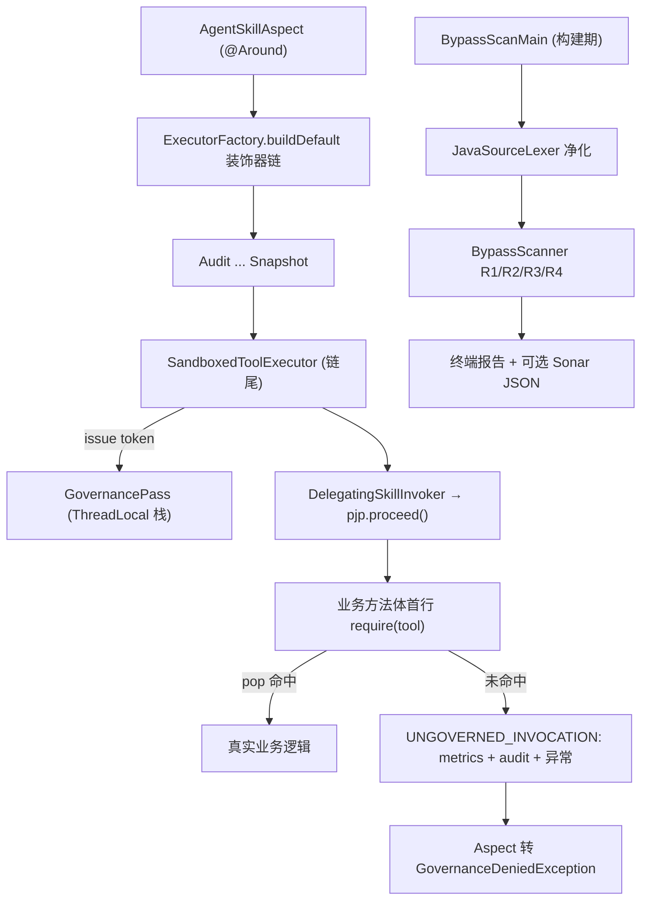

## 产品概述
在现有 Java 治理框架（core / spring-starter / delivery / agents，v1.10）上补齐两个长期标注为「⬜ 未做」的结构性缺口：把“经过治理链”从**约定**变成**前置条件**（运行时能力令牌），并把“绕过注解直调”从**无痕**变成**构建期失败**（静态扫描）。不改架构、不引入新依赖、不碰 CI 配置。

## 核心功能

**一、运行时能力令牌（D2 / CP-1）**
- 装饰器链最内层在真正执行被治理方法之前发放一次性通行证；方法体首条语句 `GovernancePass.require("<工具名>")` 消费该通行证。
- 默认 **deny**：未持令牌调用直接抛治理拒绝异常，错误码 `UNGOVERNED_INVOCATION`，同时计入指标并写审计（该指标正常必须恒为 0，非零即代表有代码在绕）。
- 令牌一次性、按线程栈承载、支持嵌套调用、异常路径必须清理；未经治理链执行（R2 待审批、取消、被任意环节拒绝）不得发放。
- 自调用（`this.x()`）与直调下层 Service 这两条最典型的绕过路径，在运行时第一次变得可被拦截且留痕。

**二、构建期静态扫描（CP-10）**
- 零依赖 Java 扫描器，检查四类问题：注解只能标在 `public`、非 `final`、非 `static`、非 `private` 方法上；方法体禁止 `ProcessBuilder` / `Runtime.getRuntime` / `Files.write` / `new FileOutputStream` / `HttpClient` / `DriverManager`；方法体首条语句必须是 `GovernancePass.require(...)` 且参数与注解 `name` 一致；Controller 不得直接注入 `*Service`。
- 违规输出**文件 + 行号 + 规则号 + 说明**，可读、可定位、可直接用于代码评审。
- 支持显式豁免：豁免必须写明规则号与理由，扫描结束时把全部豁免打印出来，不允许静默跳过。
- 可选输出 SonarQube 通用外部问题报告文件（通过 `sonar.externalIssuesReportPaths` 可被现有 SonarQube 消费），SonarQube 侧零插件、零版本绑定；默认只在本地/手动执行，仓库不新增任何 CI 配置文件。

**三、可视化效果**
- 终端输出：分组标题、逐条 `[VIOLATION] 规则号 文件:行号 说明`、末尾统计（扫描文件数 / 违规数 / 豁免数）、结果行 `RESULT: ...`；有违规时退出码非 0，可直接作为门禁。
- 与仓库既有 31 个自运行器输出风格一致（`[PASS]/[FAIL]`、`RESULT:` 收尾）。


## 技术栈
- **语言/运行时**：Java 21（`maven.compiler.release=21`），仅 JDK 标准库；**不新增任何 Maven 依赖**（离线 `mvn -o` 约束）。
- **构建**：Maven 多模块（core / spring-starter / delivery / agents），但实际验收以 `javac` + `java -cp out` 自运行器为主（JDK21 + surefire 3.2.5 存在已知 `LinkageError`）。
- **测试风格**：沿用仓库约定——带 `main` 的自运行器 + `static int pass/fail` + `check()/eq()`，`RESULT: passed=N failed=M`，失败 `System.exit(1)`。
- **日志**：`java.util.logging`（与 `AgentSkillAspect` 一致），不复用 Spring 日志。
- **静态分析**：自研词法扫描器（无 JavaParser / ArchUnit / sonar-plugin-api），仅可选输出 SonarQube 通用问题报告 JSON。

## 实施方案

### 一、能力令牌（D2 / CP-1）

**放置位置（对 docs/18 草案的一处有意改进）**：`docs/18 §3.2` 草案把 `GovernancePass` 与 `issue()` 都设为 public，这留了一个更明显的口子——任何代码都可以先 `issue("x")` 再直接调用方法，令牌就形同虚设。因此把 `GovernancePass` 放在**与链尾同包** `com.towndemontower.core.decorator`：`issue()/clear()` 包内可见（只有 `SandboxedToolExecutor` 能发牌），`require()` public（业务方法首行调用）。这是编译期约束而非运行时约束，但配合 CP-10 规则 3 形成“发牌—验牌”的闭环。

**生命周期**：
```
链内放行 → SandboxedToolExecutor.execute
          → push(tool)            // issue
          → invoker.invoke(...)   // → pjp.proceed() → 方法体首行 require(tool) → pop 命中 → 继续
          → finally: clear(tool)  // 兜底清理，防止令牌泄漏给同线程的下一次调用
```
关键不变量：
1. **只在真正执行前发放**：`SandboxedToolExecutor` 中 `cancellationToken` 检查、`registry.get` 之后、`invoker.invoke` 之前；R2 待审批、R3 拒绝、取消均不经过该点，天然不发放。
2. **一次性**：`require()` 必须命中**栈顶**且工具名一致，命中即弹出；不命中即违规（栈空、名字不符、重复调用）。
3. **必须兜底清理**：delivery / agents 的 `GovernanceFacade` 也走同一条链，但它们的目标不是带 `require` 的注解方法——若不在 `finally` 清理，残留令牌会让同线程后续的 `require` 误通过（**最危险的实现陷阱**）。
4. 阈值：单个线程栈深度上限 32，超限视为违规并清空，避免递归失控。

**违规处置**：`require()` 命中失败时——① `GovernanceMetrics.inc(UNGOVERNED_INVOCATION)`（常量已存在，位于 `core/metrics/GovernanceMetrics.java:50`，无需新增）；② `AuditStore.appendAuto("UNGOVERNED_INVOCATION", tool|reason|thread)`；③ 抛 `UngovernedInvocationException`（unchecked，含 code 与工具名）。
**对外暴露为治理拒绝**：`AgentSkillAspect` 在 `thrown[0]` 分支识别该异常并转成 `GovernanceDeniedException(UNGOVERNED_INVOCATION, ...)`，调用方拿到的仍是统一契约（`getCode()`）。
**上游配置**：`ExecutorFactory.buildDefault(...)` 已持有 `AuditStore` 与 `GovernanceMetrics`，在其中调用 `GovernancePass.configure(audit, metrics)`（**首个注册生效**，重复注册只记 WARN，避免多模块同进程内重复计数）。core 独立使用（如 `DemoRunner`）时未配置则退化为“仅抛异常不计数”，不静默放行。

### 二、静态扫描（CP-10）

**为什么不用正则直接扫源码**：`@AgentSkill` 会出现在注释、字符串、Javadoc 里；方法体需要按花括号配对定位；`// ...` 中的 `ProcessBuilder` 属误报。因此采用**三段式**：

1. `JavaSourceLexer`：单趟线性扫描，产出“与原文等长”的净化文本——注释、字符串、字符字面量全部替换为等长空格；同时保留换行符以维持行号映射。**O(n)**，无回溯正则。
2. `BypassScanner`：在净化文本上做结构化定位——
   - 命中 `@AgentSkill` → 取其后的 `(`…`)` 参数串解析 `name`（缺省用方法名）；
   - 向前回溯修饰符（`public/private/protected/static/final/abstract`）判定 R1；
   - 向前扫描到方法声明的 `{`，按花括号配对取出方法体（嵌套类、匿名类均正确）；
   - 方法体首条语句提取（跳过空白与 `{`）判定 R3，并比对工具名；
   - 方法体内关键字检索判定 R2；按 `*Controller.java` + 构造器/字段类型 `*Service` 判定 R4。
3. `SonarIssueReport`（可选）：输出 `rules` + `issues` 两段的通用问题 JSON，`filePath` 用相对仓库根的路径，`textRange.startLine` 用于定位。

**规则分级**：R1/R2/R3 = BLOCKER（计入违规、退出码 1）；R4 = WARN（默认不阻断，`--strict` 提升为阻断）。理由：现有 `DeliveryController` / `AgentController` 通过构造器注入 `*Service`，这是被认可的写法；把 R4 一刀切为阻断会让历史代码立刻红灯，违背“先有豁免流程再上扫描”的原则（`docs/18 §9`）。

**豁免机制**：方法注释块内写 `// towndemontower:allow CP10-R2 reason=<非空理由>`，仅对紧随其后的方法生效；缺 `reason` 或规则号未知 → 本身算一条违规。扫描结束时输出全部豁免（文件、规则、理由），杜绝静默。

**入口与退出码**：`BypassScanMain --root <dir> [--report <file.json>] [--strict] [--include-test]`；0=通过（含 WARN），1=存在违规，2=用法/IO 错误。默认扫描四个模块的 `src/main` 与 `src/test`，跳过 `target/`、`out/`、`.git`、`node_modules`。

**性能**：全仓约 200 余个 `.java`，单文件单趟词法 + 一次结构定位，总耗时在毫秒级；不加载类、不建 AST、不做跨文件分析，无 N+1 与重复遍历问题。

## 架构设计


令牌与扫描器**互不依赖**：一个管运行时，一个管提交时；扫描器只检查文字，不加载 `GovernancePass`。

## 目录结构

```
towndemontower-core/src/main/java/com/towndemontower/core/
├── decorator/
│   ├── GovernancePass.java              # [NEW] 一次性通行证。ThreadLocal<Deque<String>> 栈；issue/clear 包内可见（仅链尾可发牌），require(tool) public 供业务首行调用；命中栈顶同名即弹出，未命中→metrics.inc(UNGOVERNED_INVOCATION)+audit.appendAuto+抛异常；栈深上限 32；configure(audit,metrics) 首注册生效、重复注册 WARN。
│   ├── UngovernedInvocationException.java # [NEW] unchecked 异常，携带 code=UNGOVERNED_INVOCATION 与工具名/原因，供 starter 映射为治理拒绝。
│   └── SandboxedToolExecutor.java       # [MODIFY] 在 invoker.invoke 前 issue(intent.tool)，finally 中 clear(intent.tool)；取消与 registry 判空分支不发放；不改变既有返回值语义。
├── contract/
│   └── ErrorCodes.java                  # [MODIFY] 新增 UNGOVERNED_INVOCATION 常量并注明“应恒为 0”。
├── executor/
│   └── ExecutorFactory.java             # [MODIFY] buildDefault 末尾调用 GovernancePass.configure(audit, metrics)（metrics 可 null）；不改链拓扑与层数。
└── bypass/                              # [NEW] 全部零依赖、纯 JDK
    ├── JavaSourceLexer.java             # 单趟词法净化：注释/字符串/字符字面量→等长空格，保留换行以维持行号；状态机（NORMAL/LINE_COMMENT/BLOCK_COMMENT/STRING/CHAR/TEXT_BLOCK）。
    ├── BypassScanner.java               # 规则引擎与结构化定位：注解参数解析、修饰符判定、花括号配对取方法体、首语句提取；规则 R1-R4；豁免解析与统计；返回 ScanResult(files, violations, suppressions)。
    ├── BypassFinding.java               # 违规/豁免记录：规则号、文件、行号、消息、严重级（BLOCKER/WARN）、是否豁免。
    ├── SonarIssueReport.java            # 可选输出 SonarQube 通用问题 JSON（rules + issues，filePath 相对路径 + textRange.startLine）；手写字符串拼装并做 JSON 转义，不引依赖。
    └── BypassScanMain.java              # 命令行入口：--root/--report/--strict/--include-test；输出分组报表与 RESULT 行；退出码 0/1/2。

towndemontower-spring-starter/src/main/java/com/towndemontower/spring/
└── AgentSkillAspect.java               # [MODIFY] thrown[0] 分支识别 UngovernedInvocationException → 抛 GovernanceDeniedException(code, msg)，保持对外契约统一；不改 6/9 参构造签名。

towndemontower-spring-starter/src/test/java/com/towndemontower/spring/
├── AgentSkillDemo.java                 # [MODIFY] 4 个方法体首行补 GovernancePass.require("<name>")，与注解 name 逐字一致。
├── V15WiringTest.java                  # [MODIFY] Tools 内 2 个方法补首行。
├── V16SecureDefaultsTest.java          # [MODIFY] Tools 内方法补首行（含被熔断/宽限用例触及的方法）。
├── V19AuditSealWiringTest.java         # [MODIFY] Tools.write 补首行。
├── V19AnchorReplicaWiringTest.java     # [MODIFY] Tools.write 补首行。
├── QuickstartSmokeTest.java            # [MODIFY] OpsTools 两个方法补首行。
└── V111PassEnforcementTest.java        # [NEW] 装配层验证：正常调用放行；绕过切面直调（对裸对象调用）→ UNGOVERNED_INVOCATION；R2 待审批不执行也不计违规；异常路径后同线程再次调用不受污染；审计中出现 UNGOVERNED_INVOCATION。

towndemontower-core/src/test/java/com/towndemontower/core/
├── GovernancePassTest.java             # [NEW] 发放/一次性消费/名字不符/栈空/重复消费/嵌套 LIFO/异常后清理/未配置 reporter 不静默放行/栈深上限/并发线程隔离（多线程各自令牌互不干扰）。
└── bypass/
    └── BypassScannerTest.java          # [NEW] 正负样例：注释与字符串里的伪注解不误报；花括号嵌套与匿名类；R1 私有/静态/终态方法；R2 各禁词；R3 缺首行/名字不符/注释伪造；R4 注入；豁免缺理由算违规；Sonar JSON 结构与行号。

.towndemontower/
└── bypass-scan-allowlist.txt           # [NEW] R4 两处既有 Controller 的显式豁免（规则号 + 文件 + 理由），扫描时打印。

docs/
├── 29-绕过治理令牌与静态扫描.md          # [NEW] 按 PM→Arch→Dev→QA→Ops 五段写：定位、令牌生命周期与不变量、四条扫描规则、豁免策略、实测数量、残留风险（issue 仍受同包保护但反射可破、扫描器只认字面量）。
├── 08-版本任务清单.md                   # [MODIFY] 新增 v1.11 条目（D2 + CP-10 落地、测试数与回归总数）。
├── 18-防绕过方案.md                     # [MODIFY] 进度表 D2 / CP-10 由 ⬜ 改 ✅ 并注明实现类；§9 路线表格三期状态更新。
├── 19-需求对照与进度.md                 # [MODIFY] 新增 v1.11 回写段；§16.3 缺口表中 CP-10 行改 ✅。
├── 27-测试清单.md                       # [MODIFY] S-03 由 ⬜ 改 ✅；G 组缺口 1 关闭并注明由哪条用例守。
├── 28-测试执行报告.md                   # [MODIFY] 追加本次实测：各模块数量、BypassScanMain 输出摘要、退出码。
├── 00-快速上手.md                       # [MODIFY] 示例代码补 require 首行与扫描器用法（否则照抄示例会被新规则拒绝）。
└── ../README.md                         # [MODIFY] 版本推进到 v1.11、测试基线更新、新增“令牌与静态扫描”小节与运行命令。
```

## 关键代码结构

```java
// core/decorator/GovernancePass.java —— 只列签名，实现细节见方案
public final class GovernancePass {
    /** 由 ExecutorFactory 注入；首个非空注册生效，重复注册只 WARN（防多模块同进程重复计数）。 */
    public static void configure(AuditStore audit, GovernanceMetrics metrics);

    /** 业务方法体首条语句。命中栈顶同名令牌即弹出；否则计违规、写审计并抛 UngovernedInvocationException。 */
    public static void require(String tool);

    /** 仅供链尾（同包）。发牌。 */
    static void issue(String tool);

    /** 仅供链尾（同包）。兜底清理，必须在 finally 调用。 */
    static void clear(String tool);
}

// core/bypass/BypassScanner.java
public final class BypassScanner {
    public ScanResult scan(Path root, boolean includeTest);
    public static final class ScanResult {
        public int files();
        public List<BypassFinding> violations();
        public List<BypassFinding> suppressions();
    }
}
```

## 实施注意

- **令牌泄漏是头号回归风险**：`delivery` / `agents` 的 `GovernanceFacade` 复用同一条链但目标方法没有 `require`，若 `SandboxedToolExecutor` 不在 `finally` 清理，残留令牌会让同线程后续调用误通过。必须写成 `issue → try { invoke } finally { clear }`，并用“异常路径后再调用”的用例固定住。
- **存量必须一次补齐**：默认 deny 下，`AgentSkillDemo` / `V15WiringTest` / `V16SecureDefaultsTest` / `V19AuditSealWiringTest` / `V19AnchorReplicaWiringTest` / `QuickstartSmokeTest` 中 6 处工具类共约 15 个方法必须补首行，且参数与 `name` 逐字一致，否则同时被运行时与 R3 规则双重拦截。
- **不要改既有断言语义**：`V16SecureDefaultsTest` 的熔断/宽限用例、`V19*` 的锚点用例依赖“方法被真实执行”，补首行后必须复验 pass 数不变。
- **审计不重复也不遗漏**：违规由 `GovernancePass` 直写一条 `UNGOVERNED_INVOCATION`；链上 `AuditDecorator` 可能另记一条带异常的结果，属预期（两条视角不同），但不得把同一次违规计两次指标。
- **扫描器不误伤自己**：`bypass` 包内会出现 `ProcessBuilder` 字面量（在规则表里），必须放在字符串常量或用例数据里，且 R2 需排除 `bypass` 包自身（明确写入实现，不是靠巧合）。
- **零依赖硬约束**：禁止引入 JavaParser / ArchUnit / Gson；JSON 手写拼装并自行转义 `"` `\` 与控制字符。
- **不碰 CI**：不新增 `.github/workflows`、不新增脚本文件；只提供 `BypassScanMain` 与文档中的调用示例。
- 文档回写必须用实测数字（各模块用例数与全仓总数），不做推算；对 `docs/17` 中已过期的“五高危点”不做全量重写，仅在 18/19 进度表标注已关闭项。


### SubAgent
- **Dev**
  - Purpose: 实现 `GovernancePass` 令牌生命周期与零依赖 `BypassScanner` 四条规则（含词法净化、花括号配对、Sonar 报告输出）
  - Expected outcome: core 内新增可离线 `javac` 编译的零依赖实现，`BypassScanMain` 对当前仓库可跑出稳定报表与退出码
- **QA**
  - Purpose: 执行全仓回归并产出实测数字，回写 `docs/27`/`28` 的 S-03、G-1 状态与新测试基线
  - Expected outcome: 新增用例与既有 1180 项全部通过，扫描器对仓库自身零违规，报告中的数量与命令可直接复现
